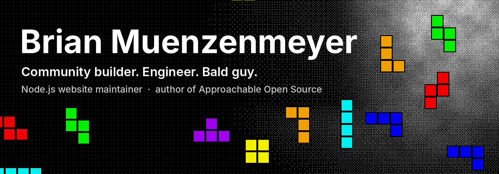
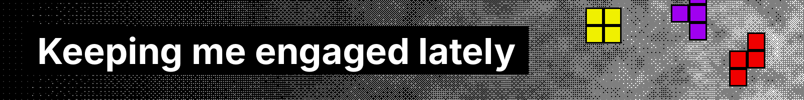
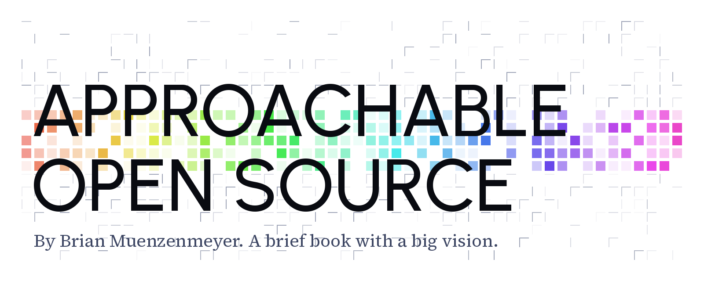
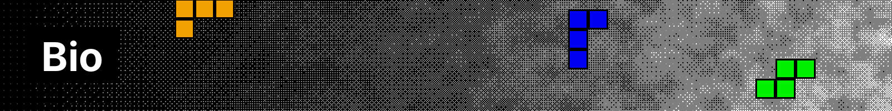
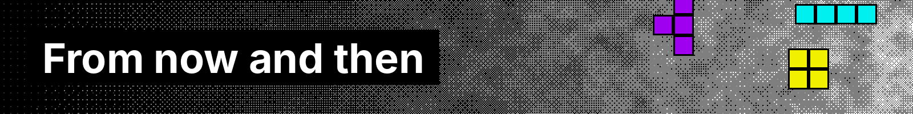
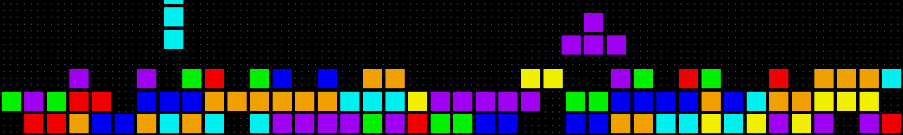

**Principal Front End Engineer** · Open Source & Program Management

[Book](https://approachableopensource.com) · [Gorilla](https://gorilla.tube) · [Open Source](https://brianmuenzenmeyer.com/hubs/opensource/) · [Blog](https://brianmuenzenmeyer.com/blog) · [Press](https://brianmuenzenmeyer.com/hubs/press)

Multifaceted community leader, engineer, and bald guy. I maintain the [Node.js website](https://nodejs.org) and wrote [_Approachable Open Source_](https://approachableopensource.com). Give it a read.

I excel at building communities and creating useful, intuitive, and delightful tools for others. Watch me debug a transient dependency collision, mentor a junior engineer on mocking within tests, stand up a GitHub Action workflow, consult on OSS licenses, and sell a concept to the C-Suite or a batch of interns, all in the same day.

The Sneelock of the Circus 🎪. When not online, I am trying to find my ☕.

<h2></h2>

### 🦍 Creator, [Gorilla](https://gorilla.tube) `🆕 BETA`

**YouTube Kids as it was meant to be. With parents in control.** Gorilla helps you create self-hosted websites that give children a safe, controlled place to watch YouTube. No algorithm, no content locked away at seeming random. Parents decide what's on the shelf.

[Learn more](https://gorilla.tube) · [Read the behind-the-scenes post](https://brianmuenzenmeyer.com/posts/2025-introducing-gorilla) · [Watch a demo](https://youtu.be/mlGSn2cY3UI)

### 📘 Author, [_Approachable Open Source_](https://approachableopensource.com)

<a href="https://approachableopensource.com">
  <picture>
    <source media="(prefers-color-scheme: dark)" srcset="assets/aos-banner-dark.png">
    
  </picture>
</a>

> _“I've written this book as a new entry in the compendium of open source thought. I don't fancy myself a thought-leader and for that we are all fortunate. But it is informed by years of success and failure working with open source software. The advice is honest; the vision bold; the mandate modest.”_

_Approachable Open Source_ is a perennial, full-spectrum primer on the open source software landscape. Discover the broad connections between you, your team, your company, and your community. It's for the curious, the busy, or the eager technologist that wants to level up their relationship with open source software. _That might be you!_

|                    | Perfect for…                                                                                                             |
| ------------------ | ------------------------------------------------------------------------------------------------------------------------ |
| 🎓 **Students**    | Understand the history, context, and potential of open source software. Find your place, I promise we need you.          |
| ⌨️ **Developers**  | Engage upstream across a full spectrum of activities.                                                                    |
| 🔧 **Maintainers** | Level up your repo with purpose. Nurture and balance community needs. Avoid burn-out.                                    |
| 💼 **Enterprise**  | Start, and scale. Secure open source dependencies and understand legal risks. Unlock your teams' future. Sustain the upstream. |

> Can't recommend it enough for folks who want a holistic view of what open source really means at the ground level.
>
> — **Coraline Ada Ehmke**, creator of Contributor Covenant & Hippocratic License

**Full-spectrum open source. [Get your copy →](https://approachableopensource.com/shop/)** $7 ebook, paperback, or bundled.

### 🟩 Maintainer, [nodejs.org](https://nodejs.org)

> _“It's been exciting maintaining the nodejs.org website. It's an intersection of technology, legacy choices, market forces, language, and people. Playing part-engineer, part-traffic cop through it all is rewarding and humbling.”_

My proudest moments are the new contributors, the Grace Hopper hackathon attendees, and the redesign.

[Read about the redesign](https://nodejs.org/en/blog/announcements/diving-into-the-nodejs-website-redesign) · [Watch the talk](https://www.youtube.com/watch?v=hRxSvDbvnaI)

<h2></h2>

Photo CC BY-NC-SA 4.0 <a href="https://www.flickr.com/photos/allthingsopen/54901754654/">All Things Open</a>

Brian is a Principal Engineer active in the open source community. A father of four boys, he juggles roles like developer, bald curmudgeon, and coffee drinker. He maintains the [Node.js website](https://nodejs.org), organizes Grace Hopper hackathons, and has been published in top web design outlets and podcasts. He and his wife Megan run a [small business](https://sweetloveadornments.com) rooted in warranty-voiding laser maintenance. Open source has opened countless doors for him, and it can for you, too!

<strong>The long version</strong>

 

Brian lives in Chanhassen, Minnesota but hails from Manitowoc, where it was always cooler by the lake and is now a fantastic ice-breaker at parties. He has four boys that keep him bald. He does a little of everything, and prefers it that way. Sometimes that’s called being a unicorn 🦄, duck 🦆, or a jack-of-all-trades 🧰, but he likes to land on the Seussical-form—Sneelock of the Circus 🎪!

With a career spanning many roles, from developer, UX team of one, product manager, analyst, and freelancer, Brian brings an experienced and broad approach to many disciplines. He and his wife Megan’s [small business](https://sweetloveadornments.com) keeps them exhausted and grounded in customer delivery, innovation, and warranty-voiding laser maintenance. He’s been published in _Smashing Magazine_, _CSS-Tricks_, _Shop Talk Show_, _Sustain_, and led workshops at Web Design Day and the Node.js Collaborator Summit. He has organized consecutive Grace Hopper hackathons towards first contributions from attendees. Open source software threads into many aspects of his life, and has opened doors he’d never thought imaginable. It can do that for you too.

When not writing or working within open source software, Brian lives out programming tropes of drinking coffee and [woodworking](https://brianmuenzenmeyer.com/posts/2022-things-ive-come-to-value/). He enjoys [soccer](https://brianmuenzenmeyer.com/posts/2025-soccer/), playing games with his sons, especially X-Wing or Chess, and never turns down a milkshake. He and Megan spend as much time outside as they can muster, often playing with their kids, deepening the pickleball rivalry on their makeshift court, chasing clouds, or digging up the yard.

<h2></h2>

| Thing | Why | Built with |
| - | - | - |
| [Walls](https://brianmuenzenmeyer.com/walls/) | A digital place to preserve the ❤️ Megan put into our homes. | [11ty](https://www.11ty.dev/), [Pantograph](https://github.com/bmuenzenmeyer/pantograph) |
| [next-i18n-starter](https://github.com/bmuenzenmeyer/next-i18n-starter) | I found it hard to compose all the demos and docs together into a fully functioning, content-centric website. So I wrote one. | [Next.js](https://nextjs.org/) |
| [makeapullre.quest](https://www.makeapullre.quest/) | A _shelved_ community resource for better-written, easier-to-review pull requests. Sorta on hiatus. Great URL. | [next-i18n-starter](https://github.com/bmuenzenmeyer/next-i18n-starter) |
| [Pattern Lab](https://patternlab.io/) | The open source project I was lead maintainer of for many years. | [Node](https://nodejs.org/en/), [lerna](https://lerna.js.org/), [auto](https://intuit.github.io/auto/) |

<strong>👻 Time capsules</strong> — early projects, rehosted on Netlify with the code left as unaltered as possible

 

| Thing | Why | Built with |
| - | - | - |
| [compassrose.js](https://compassrose.netlify.app/) | My first real open source effort. | [jQuery](https://jquery.com/) |
| [DoneDaily](https://donedaily.netlify.app/) | One of my first public web apps. | [Grunt](https://gruntjs.com/), [Sass](https://sass-lang.com/), [Respond](https://github.com/scottjehl/Respond), [yepnope](https://github.com/SlexAxton/yepnope.js/), [jQuery](https://jquery.com/), [Knockout](https://knockoutjs.com/) |
| [Simple Shift Scheduler](https://simpleshiftscheduler.netlify.app/) | One of my first public web apps, built for my father-in-law's business. | [jQuery](https://jquery.com/), [AngularJS](https://angularjs.org/), [Bootstrap](https://getbootstrap.com/) |

  <a href="https://gorilla.tube">🦍 Gorilla</a> ·
  <a href="https://brianmuenzenmeyer.com/arcade">👾 Arcade</a> ·
  <a href="https://brianmuenzenmeyer.com/walls">🎨 Walls</a> ·
  <a href="https://brianmuenzenmeyer.com/versions">👻 Versions</a> ·
  <a href="https://brianmuenzenmeyer.com/feed.xml">📟 RSS</a>
   
  <a href="https://brianmuenzenmeyer.com">brianmuenzenmeyer.com</a> ·
  <a href="https://bsky.app/profile/brianmuenzenmeyer.com">Bluesky</a> ·
  <a href="https://www.linkedin.com/in/brian-muenzenmeyer-91a77554/">LinkedIn</a>
   
  Written in Chanhassen, Minnesota.

